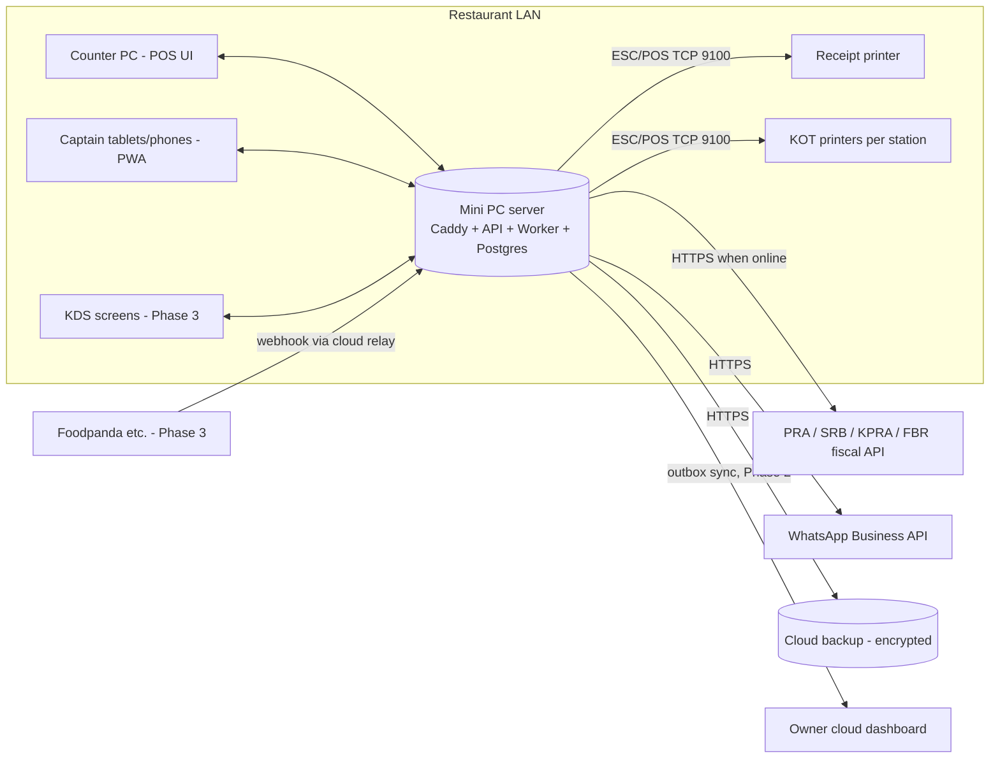

# Restaurant ERP — Architecture (v1)

Target: single desi restaurant first, multi-branch-ready. Pakistan (PRA/SRB/FBR). Urdu + English.
Owner/developer: Muneeb. Stack: Node.js/TypeScript, PostgreSQL, React.

---

## 1. Goals and hard constraints

| # | Constraint | Consequence |
|---|---|---|
| G1 | Money must never be wrong | Integer paisa, DB CHECKs, append-only ledgers, immutable settled bills |
| G2 | Counter must keep working in load-shedding / no internet | **LAN-first**: server inside the restaurant on UPS; internet only for fiscal API, WhatsApp, backups, cloud dashboard |
| G3 | Tax depends on payment method (Punjab: cash 16% / card-wallet-QR 8%) | Tax is computed **at settlement**, from effective-dated rules, never at order time |
| G4 | Every bill reported to tax authority exactly once | Fiscal outbox + idempotency key + retry worker + daily reconciliation |
| G5 | Rush-hour speed (Friday dinner) | <150 ms p95 API on LAN; KOT print <2 s; optimistic UI; no N+1 |
| G6 | Staff are not technical | Big touch UI, PIN login, Urdu labels, 3-tap order flow |
| G7 | Fraud resistance | No deletes; void/discount/refund/reprint = permissioned + reasoned + audited |
| G8 | One developer must be able to maintain it | Modular monolith, boring tech, typed end-to-end, one repo |

Non-goals (v1): microservices, Kubernetes, multi-tenant SaaS, channel managers, native mobile apps.

---

## 2. Architecture decisions (ADR summary)

| ADR | Decision | Why / trade-off |
|---|---|---|
| 1 | **Modular monolith** (one Node process, strict module boundaries) | One dev; simple deploy on a mini PC. Boundaries kept clean so a module can be extracted later |
| 2 | **TypeScript everywhere**, pnpm monorepo | Shared Zod schemas + money/tax code between API and web |
| 3 | **PostgreSQL 16 + SQL migrations (node-pg-migrate) + Kysely** (typed query builder) | We rely on CHECKs, triggers, partial indexes → hand-written SQL migrations beat ORM magic. (Prisma would hide these.) |
| 4 | **Express 4/5** + Zod validation + OpenAPI generation | Muneeb's existing skill; Fastify is a fine swap later |
| 5 | **REST + WebSocket** (Socket.IO) | REST for commands/queries; WS only for live push (KOT status, table status, new delivery order) |
| 6 | **React + Vite PWA**, TanStack Query, Zustand, Tailwind + shadcn/ui, react-i18next | Fast touch UI; installable on tablets; RTL ready |
| 7 | **Money = BIGINT paisa**; tax/rounding logic in a **pure TS package** (`packages/domain`) with exhaustive tests | Same code runs in pre-bill preview (web) and authoritative settle (api) |
| 8 | **Tax resolved at settlement** (`tax_rules` effective-dated, `payment_class`) | Compliance (G3) |
| 9 | **Append-only ledgers + reversal entries** (payments, stock, khata, audit) enforced by DB triggers | Fraud/audit (G7) |
| 10 | **Transactional outbox** for fiscal jobs, printing, WhatsApp, cloud sync | At-least-once + idempotent consumers; survives crashes/power cuts |
| 11 | **Print service** inside the API host: ESC/POS over TCP:9100; bill rendered as bitmap for Urdu | Urdu shaping on thermal printers is unreliable in text mode |
| 12 | **Docker Compose** on Ubuntu mini PC: `postgres`, `api`, `web (caddy)`, `worker`, `backup` | One command install/upgrade; Caddy gives HTTPS on LAN (needed for PWA/service worker) |
| 13 | **Server is the single source of truth** (no multi-master offline clients in v1; the only exception is ADR 0026: *add dish* and *send to kitchen* may wait on the device and are replayed idempotently) | Eliminates CRDT/conflict complexity. If server/LAN is down → paper fallback SOP. Local-first clients = Phase 3 |

---

## 3. System context



Deployment notes
- Server: small fanless PC (i3/8GB/256GB SSD), **UPS** for server+router+printers, Ethernet for counter/printers, Wi-Fi for captains.
- Static LAN IPs (server, printers). mDNS name `pos.local` + Caddy internal CA (install root cert on tablets once).
- Nightly `pg_dump -Fc` → local disk (7 days) + encrypted upload (restic → B2/S3/Drive). Monthly **restore drill**.
- Time: server NTP; all timestamps `timestamptz`; **business_date** is separate and explicit.

---

## 4. Monorepo layout

```
restaurant-erp/
  CLAUDE.md                      # rules for Claude Code
  docs/                          # this folder
  db/                            # reference SQL (001..003); real migrations live in apps/api/migrations
  apps/
    api/                         # Express app + worker entrypoints
      src/
        main.ts  worker.ts  config/  http/(middleware, errors)  ws/
        modules/
          auth/  branch/  menu/  floor/  orders/  kitchen/  billing/
          payments/  tax/  fiscal/  cash/ (shifts)  customers/  delivery/
          printing/  reports/  audit/  inventory/ (Phase 2)  sync/ (Phase 2)
        shared/ (db, tx helper, outbox, clock, ids)
      migrations/  test/
    web/                         # React PWA
      src/ app/ routes/ features/(login, floor, order, bill, shift, admin, reports) components/ i18n/ lib/(api, ws, money)
  packages/
    domain/                      # PURE: money, tax engine, split logic, rounding, state machines, zod schemas
    printing/                    # receipt/KOT layout + ESC/POS encoder + Urdu bitmap renderer
    fiscal-adapters/             # PRA, SRB, KPRA, FBR drivers behind one interface
  ops/ docker-compose.yml  Caddyfile  backup/  scripts/
```

Module rule: `routes → service → repo`. A module may call another module **only through its exported service interface or by publishing an event**; no cross-module SQL joins on tables it doesn't own (read-models for reports are the exception, in `reports/`).

---

## 5. Domain model

Aggregates: **BusinessDay → Shift**, **Order (items, KOTs, delivery)**, **Bill (lines, payments, credit notes, fiscal job)**, **Menu (items, variants, prices, modifiers, deals)**, **Ledger-style** (stock movements, khata entries, audit).
Full DDL: `db/001_core.sql`, `db/002_inventory_finance.sql`.

### State machines

```mermaid
stateDiagram-v2
  [*] --> OPEN
  OPEN --> BILLED: pre-bill printed
  BILLED --> OPEN: bill re-opened (before any payment; audited)
  BILLED --> SETTLED: settle (tender + tax + fiscal job, one tx)
  OPEN --> CANCELLED: all items void/unsent, permissioned
  SETTLED --> [*]
```


Order item: `NEW → SENT(KOT) → PREPARING → READY → SERVED`; `VOID` from NEW (free) or SENT+ (needs `kot.void` + reason; kitchen notified with cancel-KOT; counted as wastage if prepared).
Bill: `DRAFT → PRE_BILLED → SETTLED`; `VOID` only from DRAFT/PRE_BILLED. After SETTLED: **credit note only**.
Shift: `OPEN → CLOSED` (reopen = `shift.reopen`, audited). Business day closes only if no OPEN orders/shifts.

### Key rules
1. One open order per table (DB partial unique index). Table transfer = update `orders.table_id`; merge = move items into target order, cancel source (audited).
2. `order_items` hold **snapshots** (name, price, tax category, station). Menu edits never change history.
3. WEIGHT items: `line = round(unit_price_per_kg × weight_g / 1000)`; weight editable until KOT sent, then via void+re-add (kitchen already cooked).
4. Deals: parent line carries price; components are child lines (`parent_order_item_id`) with `price=0` for display and stock deduction, plus **price allocation** for reporting/tax-by-category (allocate pro-rata to component list prices, largest remainder to last component).
5. Split bill: by item (assign `order_items` to bills; one item may be shared via `portion_bps`) or equal share (N bills each `portion_bps = 10000/N`; remainder paisa to the last). Invariant: **sum of all bills' pre-tax amounts for an order = order total**.
6. Discounts: % or amount, bill-level or item-level; limit per user (`discount_limit_bps`); above limit needs `bill.discount.unlimited` approver (PIN prompt) → `discount_approved_by`. Reason mandatory.
7. Delivery/packing charges = `bill_lines` of kind `CHARGE`.
8. Khata (credit) tender: allowed only for customers with khata account and available limit; creates `khata_entries` CHARGE; later PAYMENT entries.

---

## 6. Money and tax engine (`packages/domain`)

### Money
`type Paisa = bigint`-safe branded number (use `number` for ≤ 2^53 or `bigint`; API sends integers as strings if > 2^53 — not expected). **No floating point except for weight→price, which is integer math with explicit rounding.** Rounding mode default: **half-up to paisa**; bill total rounded to nearest rupee when `billing.round_to_rupee` (difference stored in `round_off_paisa`).

### Settlement algorithm (authoritative, server-side, one DB transaction)
```
settle(billId, tenders[], idemKey):
  BEGIN
   lock bill FOR UPDATE; lock order FOR UPDATE; verify bill.status in (DRAFT, PRE_BILLED); verify shift OPEN
   lines   = bill_lines                         # frozen set
   subtotal= Σ line.net
   discount= validated (limits/approval)
   service = round(bps × (subtotal - discount))   # if enabled
   cls     = taxClass(tenders, policy)            # see below
   rule    = tax_rules where authority=branch.authority AND category AND payment_class IN (cls,'ANY')
             AND effective_from <= business_date AND (effective_to IS NULL OR >= business_date)   # exactly 1 row else ERROR (never guess)
   base    = (subtotal - discount) + (service if settings.tax.service_charge_taxable)
   tax     = round_half_up(base × rate_bps / 10000)       # per-category if multiple categories, then Σ
   pre     = subtotal - discount + service
   total0  = pre + tax
   total   = round_to_rupee(total0) ; round_off = total - total0
   UPDATE bill SET status=PRE_BILLED, taxable=pre, tax=…, tax_rate_bps, tax_rule_id, tax_payment_class=cls, round_off, total
   assert Σ tenders.amount == total   (change is separate: cash tendered - applied)
   INSERT payments (idempotency_key per tender)
   khata charge entries if any
   UPDATE bill SET status=SETTLED, settled_at, settled_by, shift_id
   INSERT fiscal_jobs (PENDING) if branch.tax_authority != NONE
   INSERT outbox/print jobs, audit_log
  COMMIT
  → after commit: worker/inline attempt submits fiscal job (timeout ≈ 3 s) → print receipt
```
`taxClass(tenders, policy)` — **policy is a setting because the legal answer for mixed tender is unconfirmed**:
- `HIGHEST_RATE_IF_ANY_NON_DIGITAL` (default, conservative): all tenders `DIGITAL` → `DIGITAL`, else `CASH_OTHER`.
- `PROPORTIONAL`: cashier enters the pre-tax share paid digitally; each share taxed at its class rate (needs CA confirmation).
Pre-bill preview shows **both totals** ("Cash Rs X / Card-QR Rs Y").

Rules the tax package must test: no rule found → hard error; two rules → hard error; rate change across midnight uses `business_date`; discount applied before tax; refunds/credit notes reverse tax at the **original bill's** rate; rounding identical in web preview and API.

### Credit note
Partial refund by line/qty → tax portion computed with original `tax_rate_bps`; refund method may differ from original; reported to authority via fiscal job; cash refund hits current shift expected cash.

---

## 7. Fiscal integration (`packages/fiscal-adapters`)

```ts
interface FiscalProvider {
  readonly code: 'PRA'|'SRB'|'KPRA'|'BRA'|'FBR'|'NONE';
  submitInvoice(doc: FiscalInvoice): Promise<{ fiscalNo: string; qr: string; raw: unknown }>;
  submitReturn(doc: FiscalReturn):  Promise<{ fiscalNo: string; qr?: string; raw: unknown }>;
  health(): Promise<{ ok: boolean; mode: 'CLOUD'|'LOCAL_DEVICE' }>;
}
```
- Drivers selected by `branches.tax_authority`; credentials in env/secret store, not DB.
- Modes: **cloud API** or **local Software Fiscal Device** (PRA spec: push invoice → get fiscal number → print number+QR → device batches to authority; works offline).
- Worker: picks `fiscal_jobs` due (`FOR UPDATE SKIP LOCKED`), exponential backoff, caps attempts then alerts manager; `idempotency_key = provider:doc_id` so retries never double-report; logs full request/response in `fiscal_jobs`.
- Receipt: if fiscal number is not available within the timeout, print the receipt marked per authority rules (**confirm with CA what is legally allowed offline**) and reprint/attach when number arrives; manager dashboard shows PENDING/FAILED count — *this number must be zero at day close* (warn, require manager override to close).
- Day-end reconciliation report: bills settled vs fiscal submitted vs authority-confirmed.
- **Build against a mock provider first**; real credentials/sandbox arrive via the CA/authority onboarding.

---

## 8. Printing (`packages/printing`)

- Print jobs are rows in an outbox (`print_jobs` — add via migration when building M4) so a printer outage doesn't lose tickets; worker retries; UI shows printer health.
- **KOT**: text-mode ESC/POS, big font, table/order/waiter/time, item × qty, modifiers, notes, `RUSH` banner; one KOT per station per "Send"; cancel-KOT variant for voids; reprint marked `REPRINT #n` and audited.
- **Customer bill/receipt**: rendered to **bitmap** (node-canvas + Noto Nastaliq/Naskh with proper shaping) so Urdu names, fiscal QR, and logo print correctly; paper 58/80 mm from `printers.paper_mm`.
- A4 invoice/PDF for catering & corporate (Phase 2) via the same layout JSON → HTML → PDF.
- Cash drawer kick via printer DK port on cash tender / no-sale (audited).

---

## 9. API design

- REST, JSON, `/api/v1`. Zod schemas in `packages/domain` generate OpenAPI + client types.
- Auth: PIN/password → short-lived JWT (15 min) + rotating refresh (stored hashed in `sessions`); device token for KDS/captain tablets; permission checks via `requirePermission('bill.refund')` middleware backed by role_permissions (cached).
- Idempotency: all money-moving POSTs require `Idempotency-Key` header (stored in `payments.idempotency_key` / dedicated table for others).
- Concurrency: `orders.version` optimistic locking (`If-Match`); settle/transfer/merge use `SELECT … FOR UPDATE` on order.
- Errors: RFC 7807 problem+json with stable `code` (e.g. `TAX_RULE_MISSING`, `SHIFT_NOT_OPEN`, `DISCOUNT_LIMIT`).
- Pagination: keyset for logs/reports. Dates: ISO; business_date as `YYYY-MM-DD`.
- WS events (rooms: `branch:{id}`, `station:{id}`, `table:{id}`): `kot.created`, `kot.status`, `table.status`, `order.updated`, `delivery.new`, `printer.status`, `fiscal.alert`.

### Main endpoints (v1)
```
auth:      POST /auth/login-pin  /auth/login  /auth/refresh  /auth/logout
setup:     GET/PUT /branch  /settings  /printers  /stations  /tables  /areas  /payment-methods
menu:      CRUD /categories /items (+variants, prices, modifier groups, deals)  PATCH /items/:id/availability
day/shift: POST /business-days/open  /business-days/:id/close   POST /shifts/open  /shifts/:id/close  POST /cash-movements
orders:    POST /orders  GET /orders?status=open  POST /orders/:id/items  PATCH /orders/:id/items/:itemId
           POST /orders/:id/send (creates KOTs)  POST /orders/:id/items/:itemId/void
           POST /orders/:id/transfer  /merge  /split-preview
bills:     POST /orders/:id/bills (pre-bill)  POST /bills/:id/discount  POST /bills/:id/settle  POST /bills/:id/reprint
           POST /bills/:id/credit-notes
delivery:  POST /orders/:id/delivery  PATCH /deliveries/:id (assign, out, delivered)  POST /riders/:id/settle-cod
customers: CRUD + khata ledger + payments
reports:   GET /reports/z-report  /sales  /items  /payments  /tax  /exceptions  /fiscal-reconciliation
admin:     GET /audit-log  GET /health  GET /fiscal/jobs
```

---

## 10. Frontend architecture

- Routes by role: `/login`, `/floor`, `/order/:id`, `/bill/:id`, `/shift`, `/delivery`, `/reports`, `/admin/*`, `/kds/:station` (Phase 3).
- State: server state in TanStack Query (WS events invalidate/patch cache); local UI state in Zustand (cart draft, selected table).
- **Order screen** (most critical): category rail → item grid (favourites/search, Urdu+Roman search) → variant chooser (Half/Full) → modifier sheet → running cart; “Send” button; hold-to-repeat qty for rotis; weight prompt for per-kg items; deal wizard.
- **Bill screen**: line list, discount (with PIN approval modal), tax shown for both classes before payment choice, tender grid (Cash/Card/JazzCash/Easypaisa/QR/Khata), split-tender, change due, **Settle** (disabled until Σ tenders = total).
- Performance: virtualised lists, prefetch menu at login, optimistic add-item, debounce nothing on money paths.
- i18n: `en`, `ur` (RTL) with per-user language; item names stored in both; numerals Latin by default.
- A11y/ergonomics: 48 px min touch targets, high-contrast theme for bright kitchens, keyboard shortcuts on counter PC.
- Failure UX: global connection banner; actions queue only for *idempotent* reads; **writes are not queued offline in v1** (clear error + retry), because the server is on the LAN.

---

## 11. Inventory & costing (Phase 2) — design now, build later

- Ingredient base units: g / ml / pcs; purchase units convert (`purchase_to_base`). `yield_bps` handles bone/fat loss; cost is stored per **usable** base unit.
- Recipes per **variant** (Half = 0.5 × Full or explicit). WEIGHT variants: recipe qty is per 1000 g sold.
- Prep items (gravy base, boiled gosht): `recipes.ingredient_id` + prep batches produce `PREP_IN` and consume raw `PREP_OUT`; dishes consume the prep item.
- On settle: write `SALE` stock_movements per ingredient (theoretical usage) and snapshot cost on `order_items.cost_paisa_snapshot`. Void-after-prepare → `WASTAGE`.
- Stocktake → variance = counted − system → `ADJUSTMENT` movements with reason; reports: food-cost %, theoretical vs actual, wastage by reason, low stock.
- Costing method: weighted-average on purchase (documented, consistent).

---

## 12. Security & compliance

- Argon2id for PIN/password; PIN lockout (5 tries/10 min); idle auto-lock on counter.
- RBAC (see seed permissions); sensitive actions require reason and write `audit_log` (before/after JSON).
- Network: API only on LAN interface; Caddy HTTPS; no DB port exposed; secrets via env/Docker secrets.
- PII: customer phones/addresses minimal; export/delete tool for customer data.
- Backups encrypted; restore tested; DB user for app has **no** privilege to disable triggers.
- Time-tampering guard: server time only; business-date rollover requires day-close by authorised user.
- Tax data retention: keep fiscal requests/responses and bills for the legal period (confirm with CA).

---

## 13. Observability & operations

- `pino` structured logs (request id, user, device), rotating; `/health` (db, printers, fiscal, disk); simple admin "System status" page.
- Alerts (WhatsApp/owner): fiscal failures > N, printer offline, backup failed, shift variance > threshold, void rate spike.
- Migrations run at container start, forward-only, backed up before each upgrade; blue/green not needed.
- Seed + demo-data script for dev; anonymised prod-snapshot loader for debugging.

---

## 14. Testing strategy

| Layer | Tooling | Must cover |
|---|---|---|
| Domain unit | Vitest + fast-check | rounding, tax per class, discounts, weight pricing, split invariants (Σ parts = whole), deal allocation |
| DB | Postgres (Testcontainers) running real migrations | CHECKs/triggers: immutability, overpay, one-open-order-per-table, day/shift rules |
| API integration | Vitest + supertest | full flows: order→KOT→bill→settle→credit note; idempotent retries; permission matrix |
| Concurrency | custom scripts | two captains one table; double-click settle; parallel fiscal workers |
| E2E | Playwright (counter + captain viewports) | 5 golden paths below |
| Printing | snapshot tests of ESC/POS bytes + image hashes | receipts (Urdu), KOT |
| Resilience | manual checklist | pull power mid-order, unplug printer, kill internet, restore backup |

Golden paths: (1) dine-in cash settle (2) half/full + modifiers + deal (3) mixed cash+card (4) split bill by item and equal (5) void after KOT + refund via credit note.

---

## 15. Build order (milestones)

M0 repo/CI/docker/migrations → M1 auth+RBAC+setup → M2 menu (variants/modifiers/deals/prices) → M3 floor+orders → M4 KOT+printing → M5 billing+tax engine → M6 payments+shift/cash+day close → M7 fiscal (mock→real) → M8 reports+audit UI → M9 hardening (backup, health, load test, UAT) → **pilot with parallel run**. Detailed acceptance criteria: `docs/PHASE-1-TASKS.md`.

---

## 16. Open questions (must be answered before M5/M7)

1. Province/authority for the restaurant (PRA/SRB/KPRA/BRA/FBR-ICT) and its registration numbers.
2. CA-confirmed rules: mixed tender tax, service charge/tip taxability, packing/delivery charge taxability, aggregator orders, credit-note reporting, offline receipt wording.
3. Fiscal mode: cloud API vs local device; credentials/sandbox access.
4. Menu structure: how many per-kg items, deals complexity, price differences per channel.
5. Printers: models, LAN vs USB, counts per station.
6. Is stock tracking required at launch or after billing is stable?
7. Does the owner want WhatsApp daily summary at launch?
