# Web demo — POS screens (login, floor, order)

```bash
pnpm db:reset            # migrations + demo branch + dev users
pnpm dev                 # api http://localhost:18080 · web http://127.0.0.1:15173
```

1. Import the sample menu once (see [M2 demo](M2.md)) and create some tables (`POST /tables`), e.g. as `owner`.
2. Open <http://127.0.0.1:15173>, sign in as **cashier** / PIN **1234** (other dev users: `manager`, `captain`, `kitchen`, `store`, `accountant`, `owner`; PIN 1234, password `Dev#Passw0rd`).
3. **Open day**, **Open shift** (float), tap a table, tap items. Half/Full, modifiers, weight and deals open a bottom sheet. The cart total is always the server's.
4. Open the app on a second device/browser as **captain**: the floor shows T1 occupied within ~3 s; tapping it joins the same order.
5. Tap **اردو** for Urdu (right-to-left, Urdu item names).

## Screenshots

Captured by `SCREENSHOTS=1 pnpm test:e2e` (`e2e/screenshots.spec.ts`).

| | |
| --- | --- |
| Login (PIN pad) | 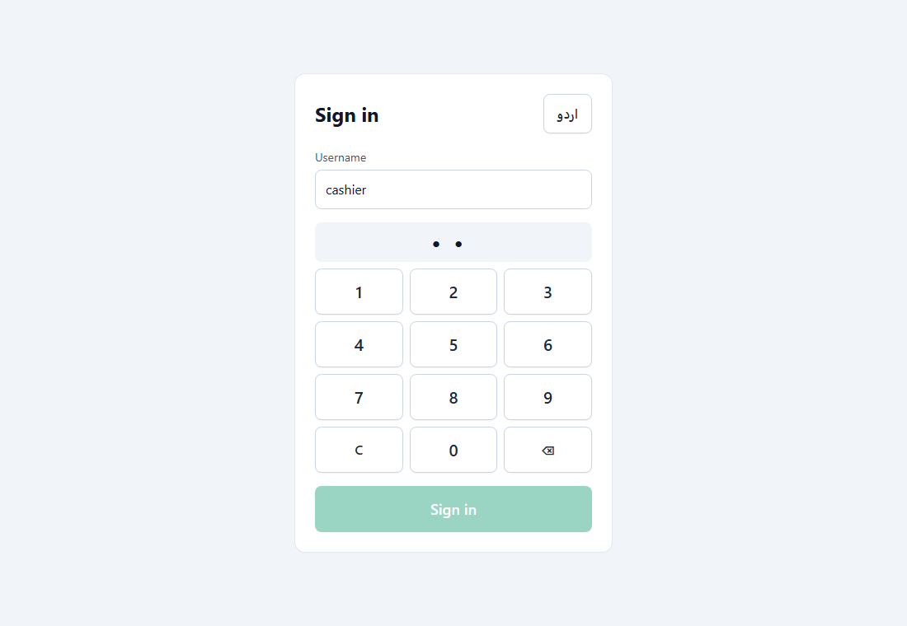 |
| Floor | 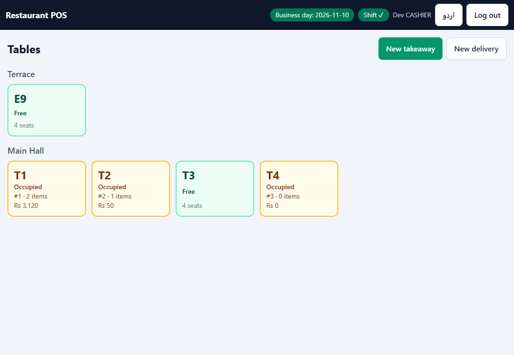 |
| Order | 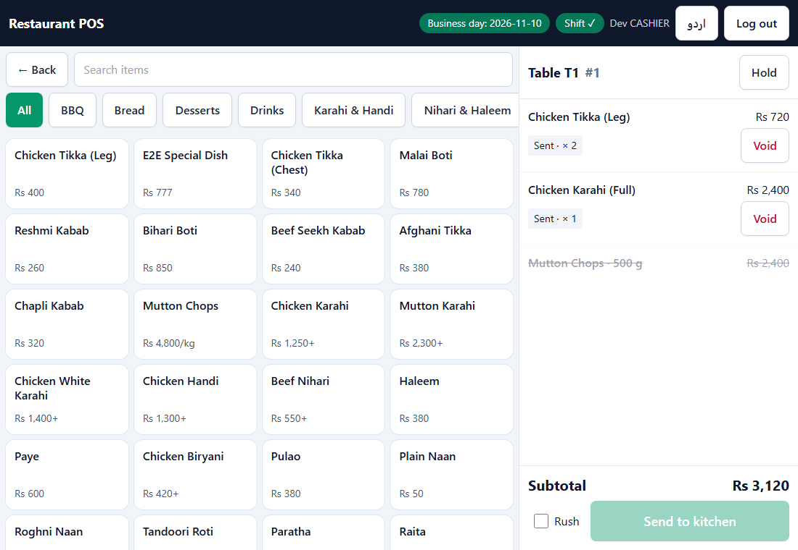 |
| Item sheet (Half/Full) | 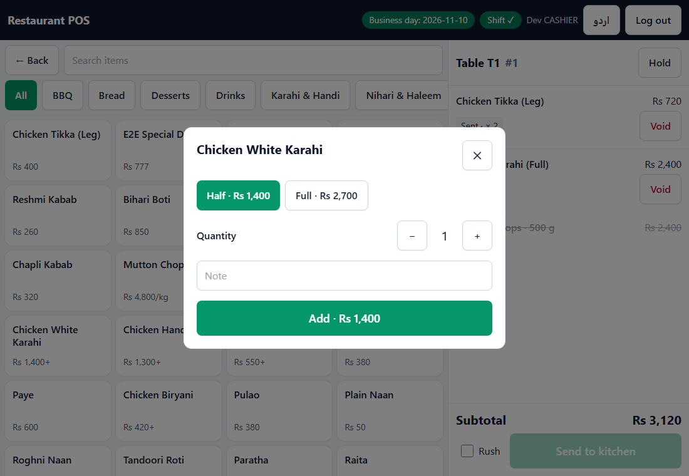 |
| Order in Urdu (RTL) | 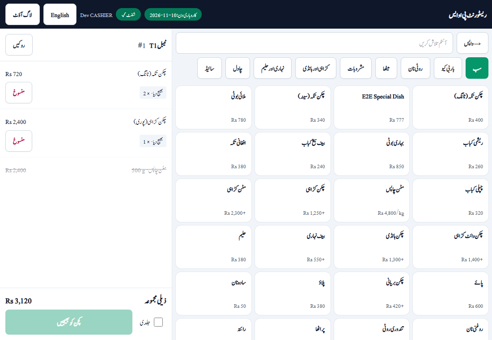 |
| Floor in Urdu | 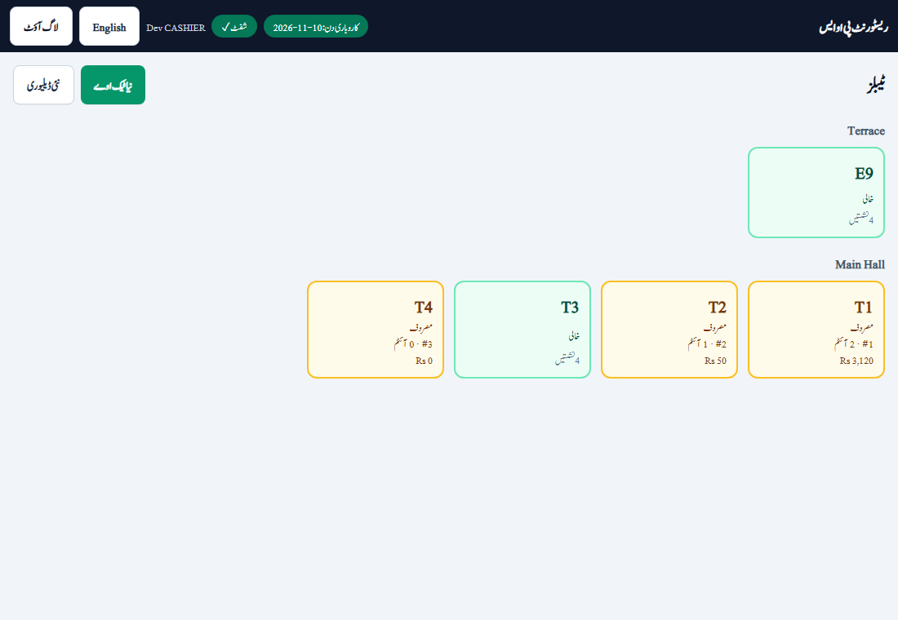 |
| Tablet portrait | 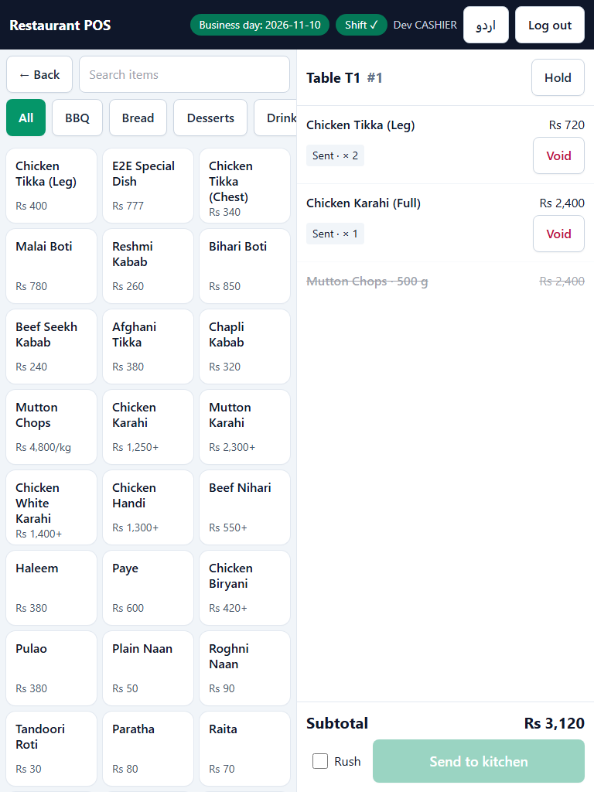 |

## Admin area (owner / manager)

The **Admin** button (top bar) opens four sections, each visible only to roles that have the permission (the API enforces it too):

| Section | Needs | What you can do |
| --- | --- | --- |
| **Menu** | `menu.manage` | search/filter; edit prices inline (Enter saves, invalid amounts are flagged); 86 toggle; activate/deactivate; **New item** (variants + prices per channel), edit, add variant; **Import CSV** (*Check file* lists problems by line, then *Apply import*); **Export CSV** |
| **Printers** | `settings.manage` | add/edit printers, live status (OK / offline / not used yet), queue length, **Test page**, which printer prints which station, failed print jobs with *Retry* |
| **Tables** | `settings.manage` | areas and tables, activate/deactivate (the floor updates) |
| **Users** | `user.manage` | create users (PIN and/or password), reset a PIN, activate/deactivate, unlock a locked account |

| | |
| --- | --- |
| Menu admin | 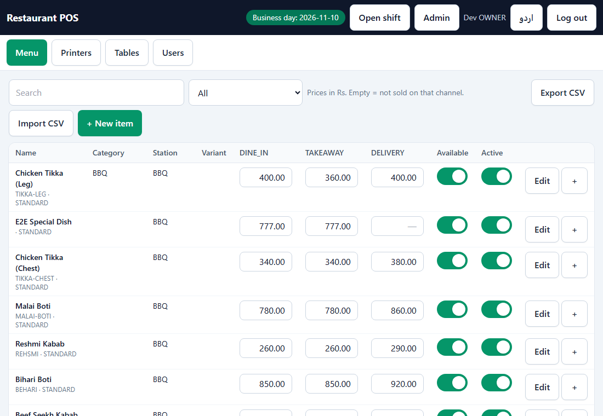 |
| New item | 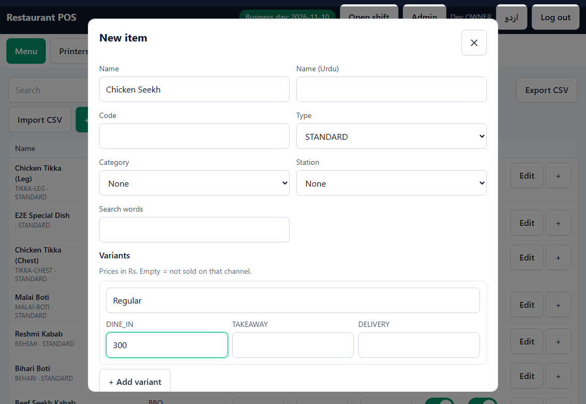 |
| CSV import problems | 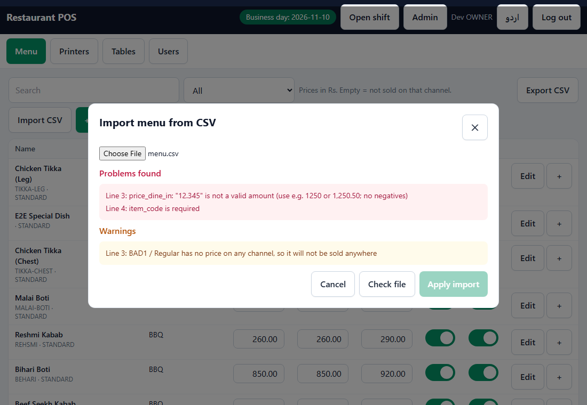 |
| Printers | 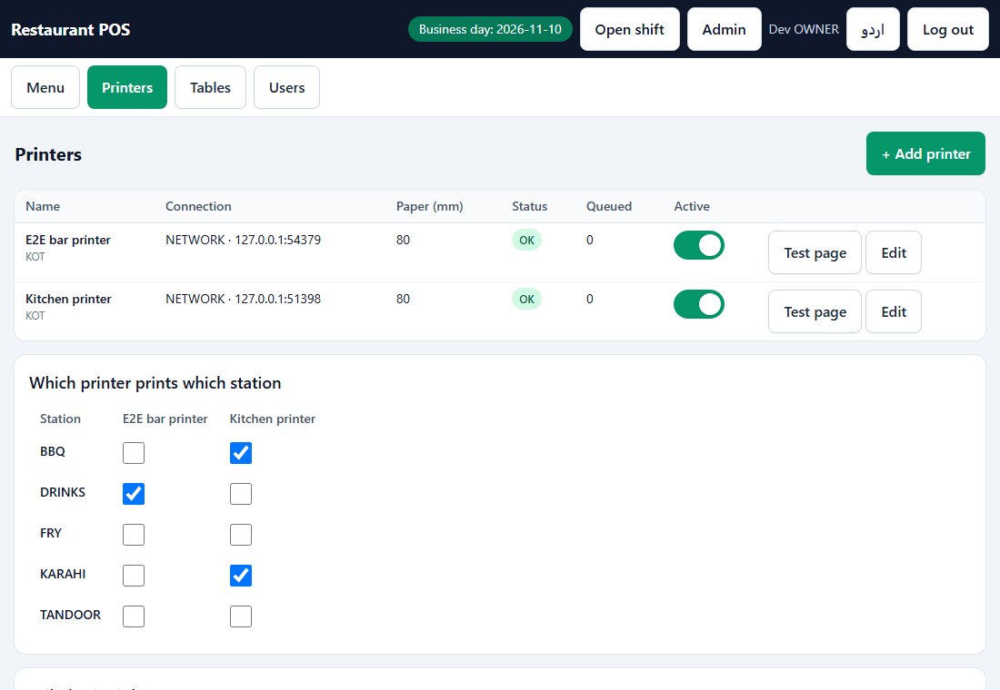 |
| Users | 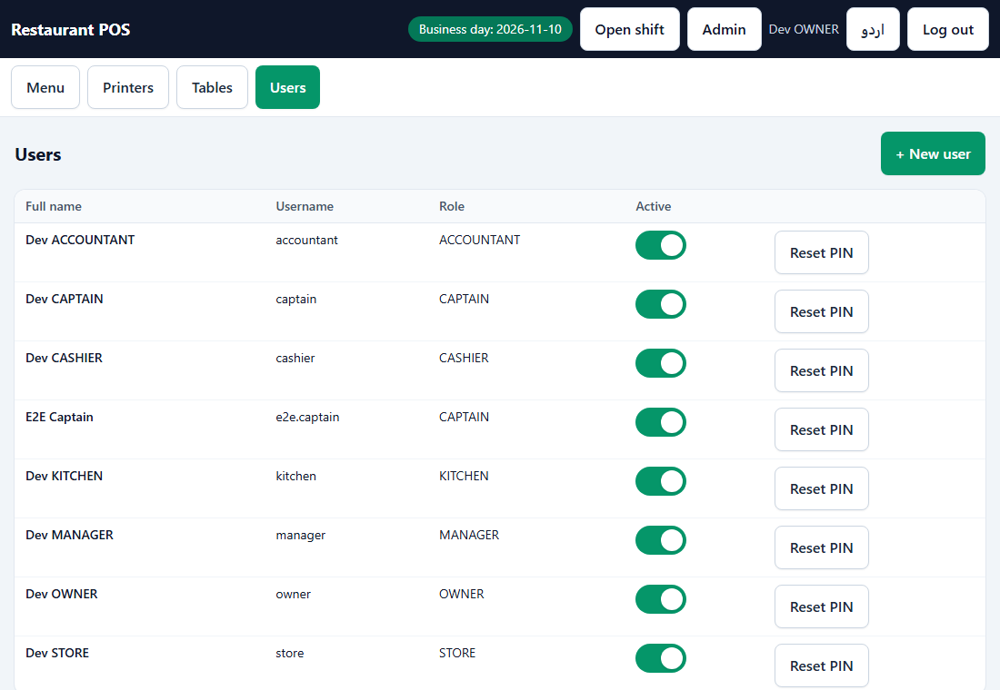 |
| Menu admin in Urdu | 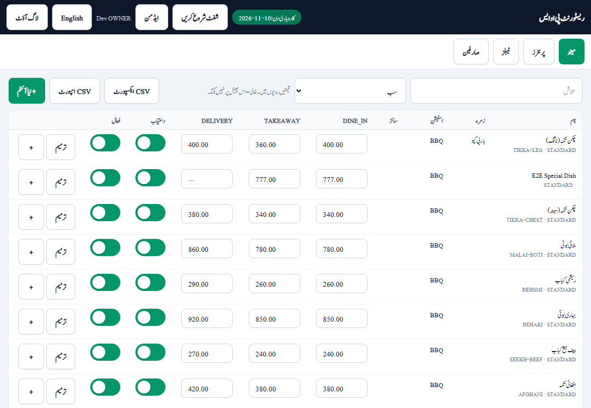 |

## Tests

```bash
pnpm --filter @erp/web test      # 31 unit/component tests
pnpm test:e2e                    # 10 browser tests against a fresh e2e database (needs Docker running)
```

Design: [ADR 0005](../adr/0005-web-app.md).
